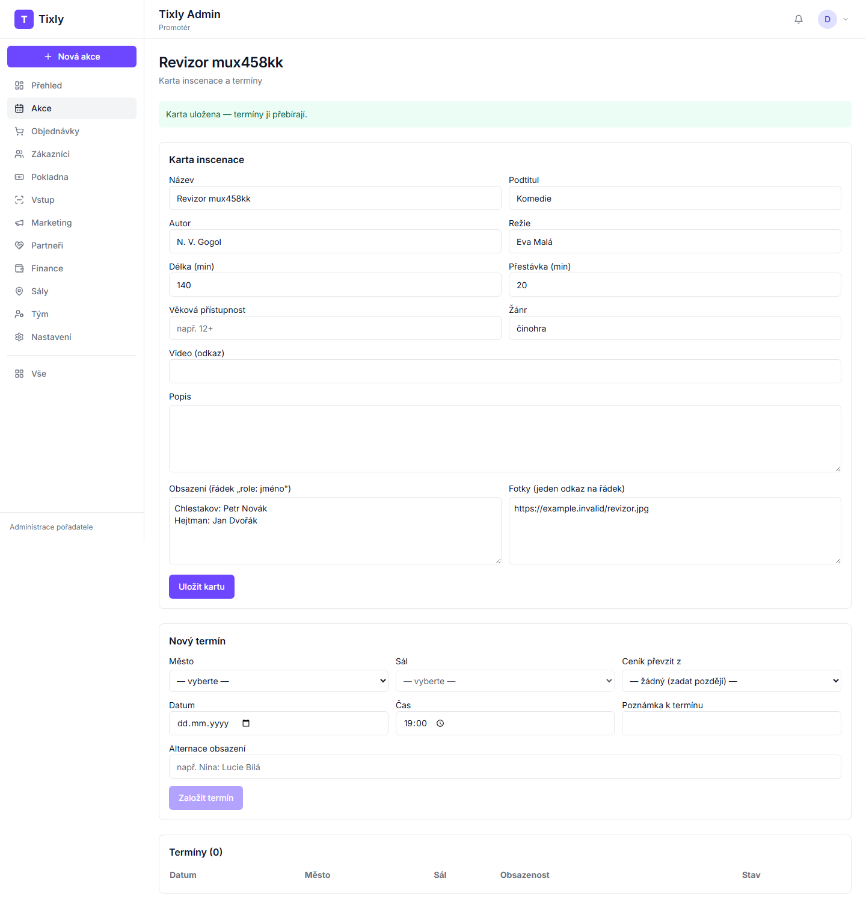
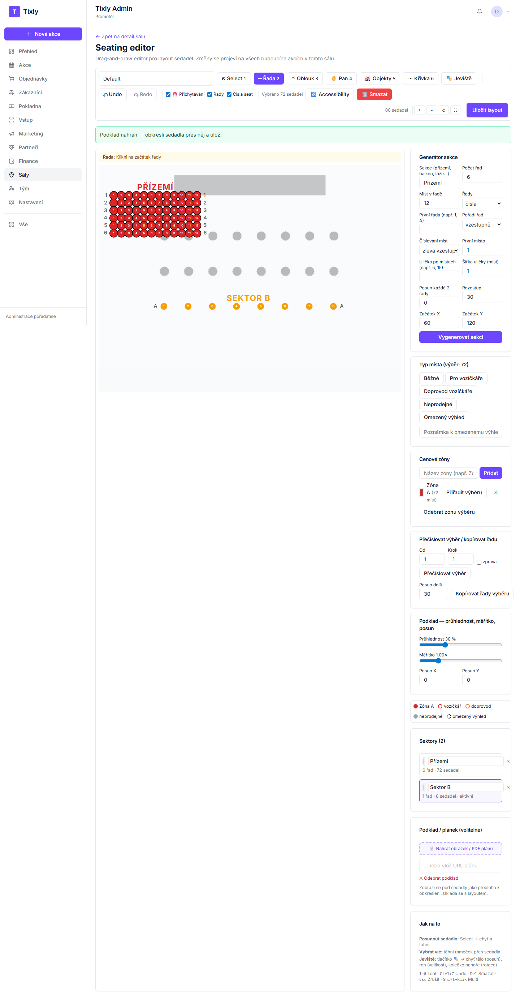
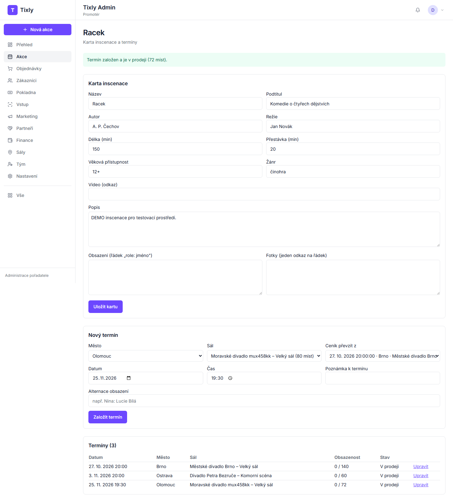
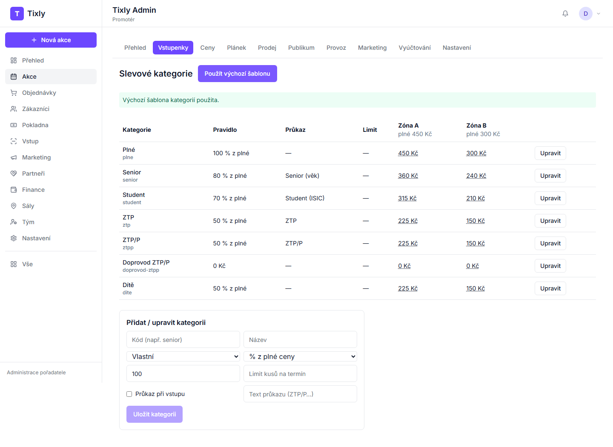
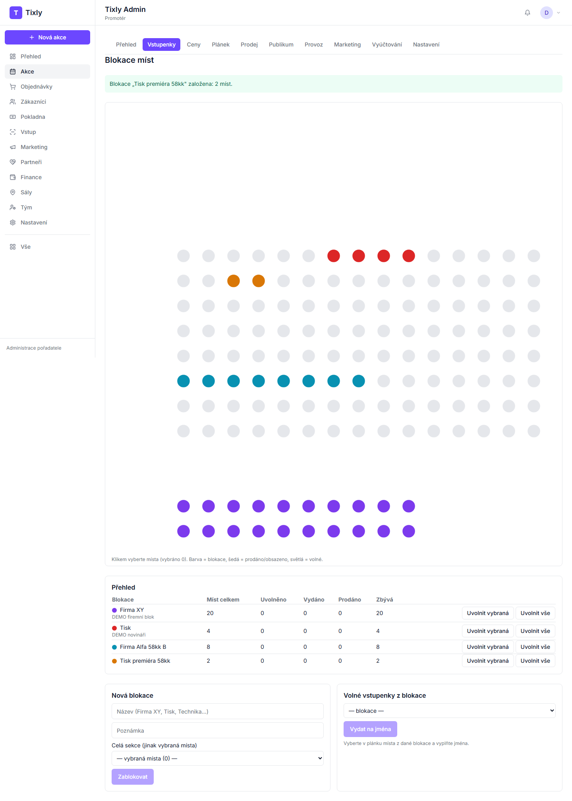
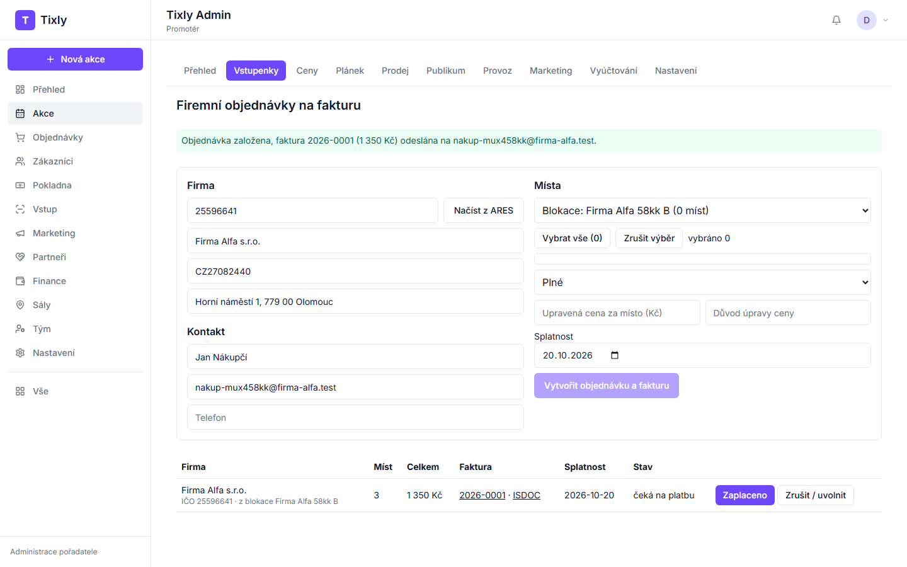
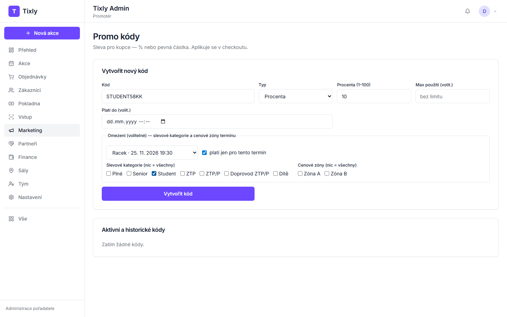
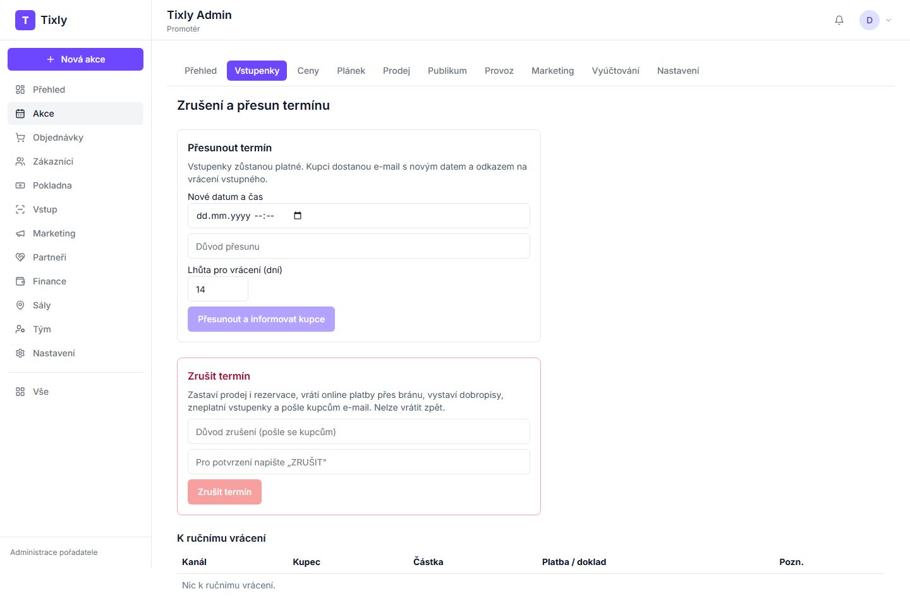
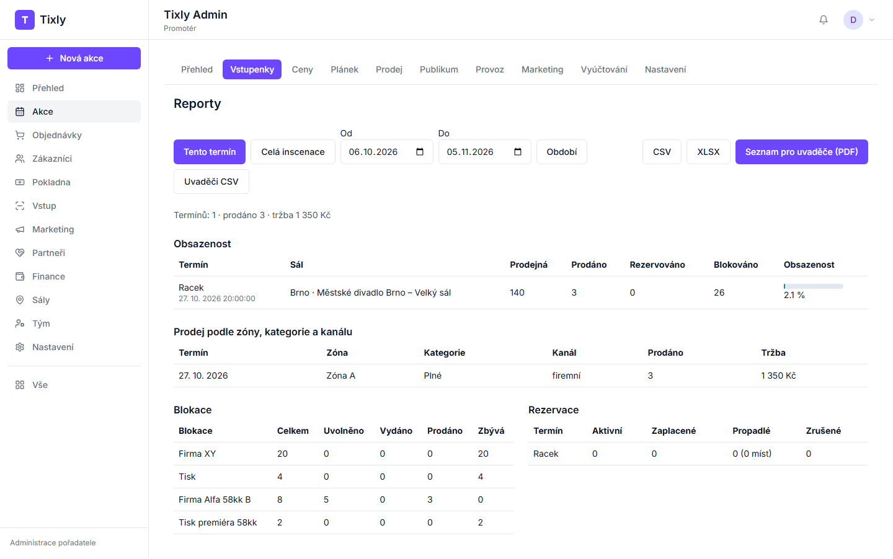

# Tixly — příručka pro agenturu

Návod pro vlastníka divadelní agentury: inscenace, sály, termíny, blokace, firemní objednávky, slevy, přesun a zrušení,
reporty. Vše se dělá v administraci (po přihlášení, adresa `…/admin`).

## Co potřebujete mít připravené

- Přihlašovací e-mail a heslo vlastníka účtu.
- K inscenaci: název, autora, režii, délku, obsazení (role a jména), odkaz na fotku (adresa obrázku na webu).
- K novému sálu: název místa, město, adresu, počet řad a míst v řadě. Plánek hlediště jako obrázek nebo PDF, pokud chcete
  sedadla obkreslit.
- K termínu: datum a čas a termín, ze kterého převezmete ceník.
- K firemní objednávce: IČO firmy, jméno a e-mail kontaktní osoby.
- E-maily pokladních a uvaděček (pozvete je v **Tým** → **Pozvat člena**).

Levé menu: **Přehled · Akce · Objednávky · Zákazníci · Pokladna · Vstup · Marketing · Partneři · Finance · Sály · Tým ·
Nastavení · Vše**. Inscenace a promo kódy najdete ve **Vše**.

**Nástroje termínu** (blokace, kategorie, firemní objednávky, rezervace, zrušení a přesun, reporty) otevřete vždy stejně:
**Vše** → **Produkce a reprízy** → u inscenace **Karta a termíny** → v tabulce **Termíny** u termínu **Upravit** → záložka
**Vstupenky** → příslušná karta.

---

## 1. Nová inscenace s fotkou a obsazením

1. **Vše** → **Produkce a reprízy**.
2. Napište název do pole „Název inscenace (např. Racek)" a klikněte na **Vytvořit**. U nové inscenace klikněte na
   **Karta a termíny**.
3. Vyplňte Podtitul, Autor, Režie, Délka (min), Přestávka (min), Věková přístupnost, Žánr a Popis.
4. **Obsazení (řádek „role: jméno")** — každou roli na nový řádek, např. `Chlestakov: Petr Novák`.
5. **Fotky (jeden odkaz na řádek)** — vložte adresu obrázku, např. z webu divadla.
6. Klikněte na **Uložit kartu**. Nahoře se objeví „Karta uložena — termíny ji přebírají."

## 2. Nové místo a sál v novém městě (generátor a obkreslení plánku)

1. V menu klikněte na **Sály**.
2. V **Knihovně míst** vyplňte **Místo**, **Město**, **Adresa** a klikněte na **Přidat místo**.
3. V kartě nového místa napište název sálu („Nový sál (např. Velký sál)") a klikněte na **Přidat sál**. Otevře se editor
   plánku (**Seating editor**). Později ho otevřete v knihovně odkazem **Editor plánku** u sálu.
4. **Generátor sekce** (vpravo): vyplňte Sekce, Počet řad, Míst v řadě a klikněte na **Vygenerovat sekci**. Další sekci
   (balkon) přidáte stejně — změňte „Začátek Y", ať se sekce nepřekrývají.
5. **Cenové zóny:** napište název zóny a klikněte na **Přidat**. Vyberte místa nástrojem **Select** (klávesa 1) — rámečkem
   tažením přes sedadla — a u zóny klikněte na **Přiřadit výběru**. **Bez přiřazené zóny v sále nejde založit termín.**
6. **Obkreslení (volitelné):** v části „Podklad / plánek (volitelné)" klikněte na **Nahrát obrázek / PDF plánu**. Nástrojem
   **Řada** (klávesa 2) klikněte na začátek a konec řady na podkladu. Průhlednost a měřítko podkladu nastavíte posuvníky.
7. Typ místa (Pro vozíčkáře, Doprovod vozíčkáře, Neprodejné, Omezený výhled) nastavíte výběrem míst v části **Typ místa**.
8. Klikněte na **Uložit layout**. Zpět se dostanete odkazem **← Zpět na detail sálu** (vede do knihovny míst).

## 3. Nový termín v novém sále, ceník, slevové kategorie, zveřejnění

1. **Vše** → **Produkce a reprízy** → **Karta a termíny**.
2. V části **Nový termín** zvolte **Město** a **Sál**, v poli **Ceník převzít z** vyberte termín, jehož ceny použijete,
   vyplňte **Datum** a **Čas** a klikněte na **Založit termín**.
3. **Zveřejnění:** první termín nové inscenace jde ke schválení provozovateli Tixly („čeká na schválení"); každý další
   termín schválené inscenace je hned v prodeji („Termín založen a je v prodeji"). Slevové kategorie proto nastavte hned.
4. **Slevové kategorie:** u termínu **Upravit** → záložka **Vstupenky** → **Slevové kategorie** → **Použít výchozí šablonu**.
   Vlastní kategorii přidáte formulářem dole (Kód, Název, ceny) tlačítkem **Uložit kategorii**.

## 4. Blokace pro firmu a pro tisk, uvolnění části do prodeje

1. Termín → **Upravit** → **Vstupenky** → **Blokace míst**.
2. V části **Nová blokace** napište název (např. *Firma XY*). Buď v poli **Celá sekce (jinak vybraná místa)** vyberte sekci,
   nebo klikněte na plánku na jednotlivá místa. Klikněte na **Zablokovat**.
3. Stejně založte blokaci *Tisk*.
4. **Uvolnění do prodeje:** klikněte na plánku na místa blokace, která chcete prodávat, a v **Přehledu** u blokace klikněte
   na **Uvolnit vybraná**. **Uvolnit vše** vrátí do prodeje všechna zbývající místa blokace — hned, bez dalšího dotazu.
5. Volné vstupenky na jména: v části **Volné vstupenky z blokace** vyberte blokaci, klikněte na místa, vyplňte jména a
   **Vydat na jména**.

## 5. Firemní objednávka na fakturu a označení zaplacení

1. Termín → **Upravit** → **Vstupenky** → **Firemní objednávky**.
2. Napište **IČO** a klikněte na **Načíst z ARES**. Doplňte kontakt (Jméno, E-mail, Telefon).
3. V části **Místa** zvolte **Volná místa** nebo blokaci firmy a vyberte místa. Zvolte kategorii, případně upravenou cenu
   s důvodem, a splatnost.
4. Klikněte na **Vytvořit objednávku a fakturu**. Faktura odejde firmě e-mailem.
5. Až platba dorazí: u objednávky klikněte na **Zaplaceno**. V okně prohlížeče „Reference platby (VS / ID transakce):"
   vyplňte variabilní symbol a potvrďte **OK**. Vstupenky odejdou firmě e-mailem.
6. Storno: **Zrušit / uvolnit** → v okně napište důvod a potvrďte **OK** (vystaví se dobropis, místa se vrátí). Tlačítko
   **Zrušit** v okně akci zastaví.

## 6. Promo kód omezený na slevovou kategorii

1. **Vše** → **Promo kódy**.
2. V části **Vytvořit nový kód** vyplňte **Kód** (např. *STUDENT10*), **Typ** (Procenta / Pevná částka (Kč)) a výši slevy,
   případně **Max použití (volit.)** a **Platí do (volit.)**.
3. **Omezení (volitelné):** vyberte termín a zaškrtněte slevovou kategorii (**Slevové kategorie (nic = všechny)**).
4. Klikněte na **Vytvořit kód**. Kód se objeví v seznamu **Aktivní a historické kódy**.

## 7. Přesun a zrušení termínu

Termín → **Upravit** → **Vstupenky** → **Zrušení a přesun**.

**Přesun:** vyplňte **Nové datum a čas**, důvod přesunu a **Lhůta pro vrácení (dní)** → **Přesunout a informovat kupce**.
Prohlížeč se zeptá „Přesunout termín? Všem kupcům odejde e-mail s novým datem." — **OK** přesun provede, **Zrušit** nic
nezmění. Vstupenky zůstanou platné, kupci dostanou e-mail s novým datem a odkazem na vrácení vstupného.

**Zrušení:** vyplňte důvod (pošle se kupcům), napište **ZRUŠIT** a klikněte na **Zrušit termín**. Prohlížeč se zeptá
„Zrušit termín? Vstupenky přestanou platit a kupcům se vrátí peníze." — **OK** termín zruší. Online platby se vrátí přes
platební bránu, vystaví se dobropisy, vstupenky přestanou platit, kupci dostanou e-mail. Platby k ručnímu vrácení (hotově,
převodem) najdete v tabulce **K ručnímu vrácení**. Zrušení nelze vzít zpět. V seznamu **Akce** je termín označen **Zrušeno**.

## 8. Reporty termínu a seznam pro uvaděčky

1. Termín → **Upravit** → **Vstupenky** → **Divadelní reporty**.
2. Přepínejte **Tento termín** / **Celá inscenace** / **Období**: obsazenost, prodej podle zóny, kategorie a kanálu,
   blokace a rezervace.
3. **CSV** / **XLSX** stáhne report do tabulky.
4. **Seznam pro uvaděče (PDF)** — místa, kategorie, jména a sloupec „Ověřit průkaz". **Uvaděči CSV** — totéž do tabulky.

---

## Když něco nefunguje

| Co vidíte | Co udělat |
|---|---|
| „Sál nemá místa přiřazená do cenových zón." při zakládání termínu | **Sály** → **Editor plánku** → vyberte místa → u zóny **Přiřadit výběru** → **Uložit layout** → termín založte znovu. |
| „Ve výběru nejsou volná místa." při blokaci | Vybraná místa jsou už prodaná nebo v jiné blokaci. Vyberte na plánku světlá (volná) místa. |
| „Soubor se nepodařilo stáhnout (HTTP …)." u reportů | Zkuste to znovu; pokud to přetrvá, obnovte stránku a přihlaste se znovu. |
| ARES údaje nenačte | Zkontrolujte IČO; pokud firma v ARES není, vyplňte Název firmy, DIČ a Sídlo ručně. |
| Termín je hned v prodeji, ale ještě nemáte slevy | Další termíny schválené inscenace jdou do prodeje hned — kategorie nastavte ihned po založení (bod 3.4). |
| Uvolnili jste blokaci omylem | Místa jsou zpět v prodeji; dokud je nikdo nekoupí, vyberte je na plánku a založte blokaci znovu. |
