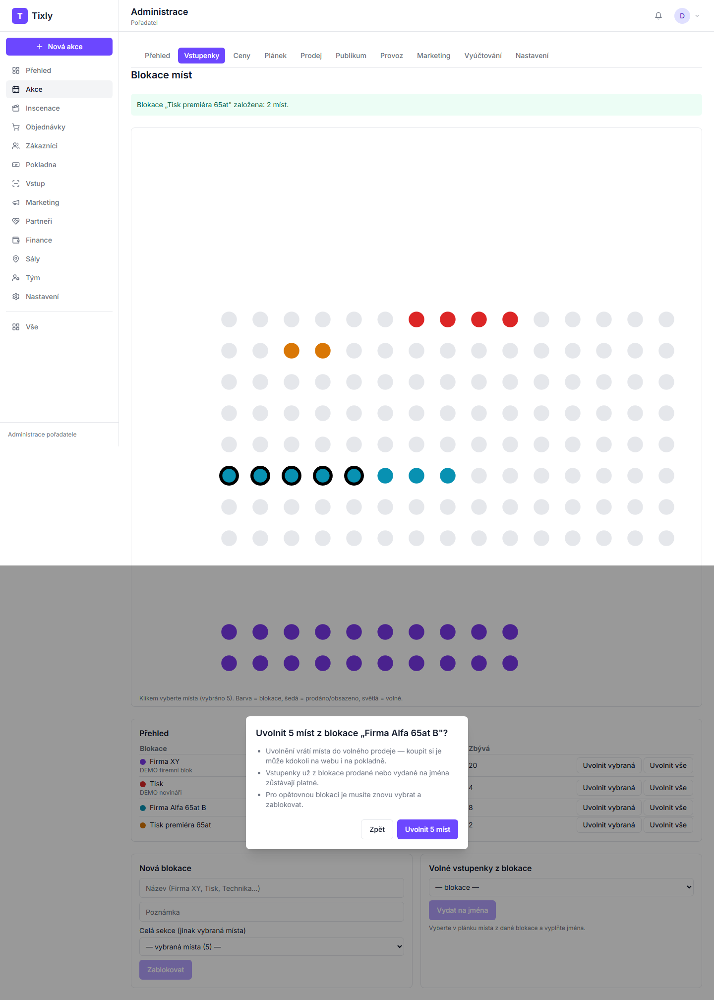
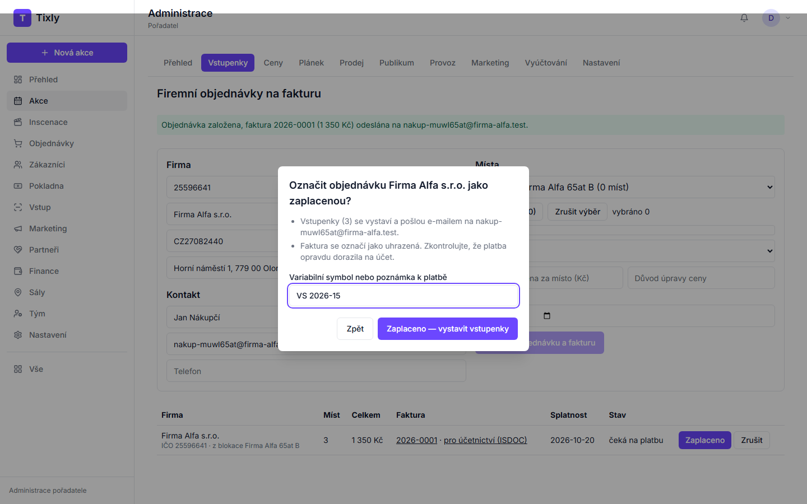
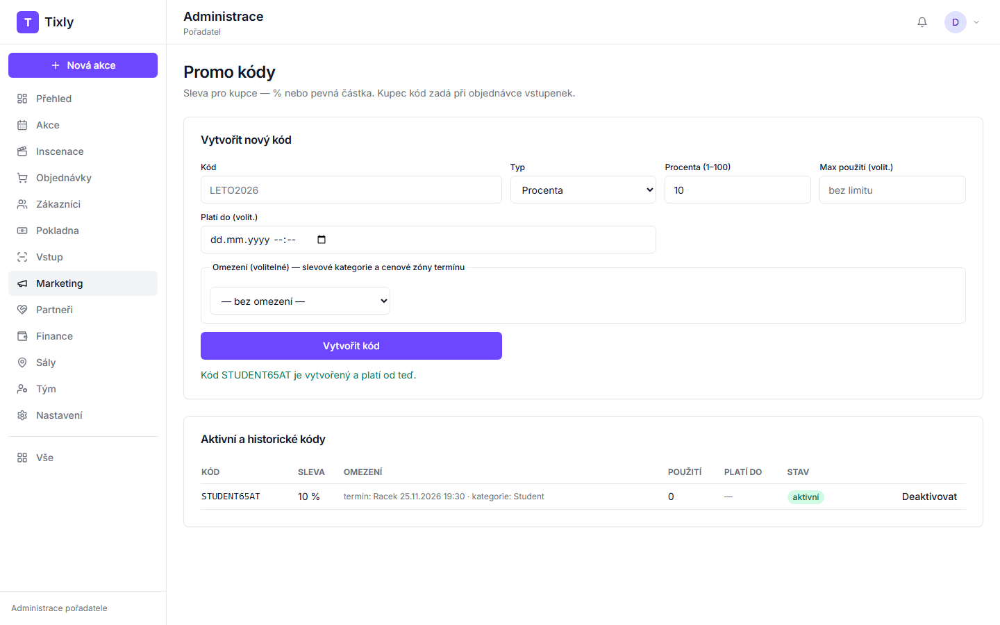
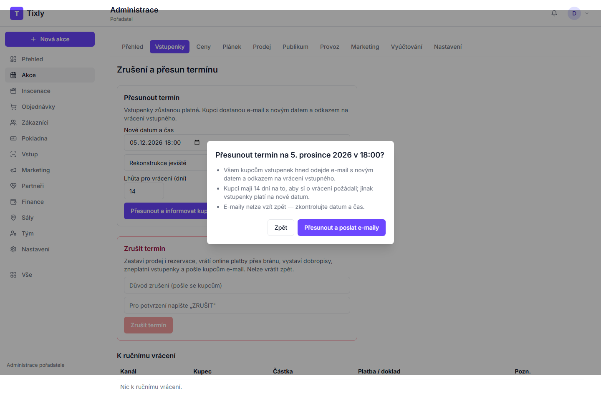

# Tixly — příručka pro agenturu

Návod pro vlastníka divadelní agentury: inscenace, sály, termíny, blokace, firemní objednávky, slevy, přesun a zrušení,
reporty. Vše se dělá v **Administraci** (po přihlášení vpravo nahoře, nebo adresa `…/admin`).

## Co potřebujete mít připravené

- Přihlašovací e-mail a heslo vlastníka účtu.
- K inscenaci: název, autora, režii, délku, obsazení (role a jména), fotku (JPG/PNG/WebP do 5 MB).
- K novému sálu: název místa, město, adresu, počet řad a míst v řadě. Pokud máte plánek hlediště jako obrázek nebo PDF, mějte ho
  po ruce — sedadla podle něj obkreslíte.
- K termínu: datum a čas, ze kterého termínu převzít ceník, nebo ceny cenových zón.
- K firemní objednávce: IČO firmy, jméno a e-mail kontaktní osoby.
- Pro pokladní a uvaděčky: jejich e-maily (pozvete je v **Tým → Pozvat**, role **Pokladna** nebo **Vstup a provoz**).

Levé menu: **Přehled · Akce · Inscenace · Objednávky · Zákazníci · Pokladna · Vstup · Marketing · Partneři · Finance · Sály · Tým ·
Nastavení**. Cokoli dalšího najdete v **Vše**.

---

## 1. Nová inscenace s fotkou a obsazením

1. V menu klikněte na **Inscenace**.
2. Napište název (např. *Revizor*) a klikněte na **Vytvořit**. Otevře se karta inscenace.
3. Vyplňte Podtitul, Autor, Režie, Délka (min), Přestávka (min), Věková přístupnost, Žánr a Popis.
4. **Obsazení:** do řádku napište *Roli* a *Jméno herce*, klikněte na **Přidat roli** pro další řádek. Řádek odstraníte tlačítkem
   **Odebrat**.
5. **Fotky:** klikněte na **Nahrát fotku z počítače** a vyberte soubor. Fotka se přidá do pole „Odkazy na fotky".
6. Klikněte na **Uložit kartu**. Nahoře se objeví „Karta uložena — termíny ji přebírají."

## 2. Nové místo a sál v novém městě (generátor a obkreslení plánku)

1. V menu klikněte na **Sály**.
2. V **Knihovně míst** vyplňte **Místo**, **Město**, **Adresu** a klikněte na **Přidat místo**.
3. V kartě nového místa napište název sálu (např. *Velký sál*) a klikněte na **Přidat sál**. Rovnou se otevře **Editor plánku sálu**.
4. **Generátor sekce** (vpravo): vyplňte Sekce (např. *Přízemí*), Počet řad, Míst v řadě a klikněte na **Vygenerovat sekci**.
   Další sekci (balkon) přidáte stejně — jen změňte „Začátek Y", ať se sekce nepřekrývají.
5. **Cenové zóny:** napište název (např. *Zóna A*), klikněte na **Přidat**. Pak vyberte místa — nástroj **Výběr** (klávesa 1),
   tažením myši rámečkem přes sedadla — a u zóny klikněte na **Přiřadit výběru**.
   **Bez přiřazené zóny se místa v termínech neprodávají** — editor vás po uložení upozorní, kolik míst zónu nemá.
6. **Obkreslení podle plánku (volitelné):** v části „Podklad / plánek" klikněte na **Nahrát obrázek / PDF plánu**. Plánek se zobrazí
   pod sedadly. Zvolte nástroj **Řada** (klávesa 2), klikněte na začátek a konec řady na plánku, zadejte počet míst a klikněte na
   **Přidat řadu**. Průhlednost a měřítko podkladu nastavíte posuvníky.
7. Typ místa (pro vozíčkáře, doprovod, omezený výhled) nastavíte výběrem míst a tlačítkem v části **Typ místa**.
8. Klikněte na **Uložit plánek**. Zpět do knihovny se dostanete odkazem **← Zpět do knihovny míst**.

## 3. Nový termín v novém sále, ceník, slevové kategorie, zveřejnění

1. **Inscenace** → u inscenace **Karta a termíny**.
2. V části **Nový termín** zvolte **Město** a **Sál**, v poli **Ceník převzít z** vyberte termín, jehož ceny chcete použít
   (nebo „žádný" a zadejte ceny zón), vyplňte **Datum** a **Čas** a klikněte na **Založit termín**.
3. **Zveřejnění:** první termín nové inscenace jde ke schválení provozovateli Tixly (stav „Ke schválení"); každý další termín
   schválené inscenace je **ihned v prodeji**. Slevové kategorie proto nastavte hned po založení (krok 4).
4. Slevové kategorie: v tabulce **Termíny** klikněte u termínu na **Upravit** → záložka **Vstupenky** → **Slevové kategorie** (případně pod **Další funkce**) →
   **Použít výchozí šablonu** (plné, senior, student, ZTP/P, doprovod ZTP/P…). Vlastní kategorii přidáte formulářem dole
   (stačí název a cena; kód se doplní sám).

> Pokud se objeví „Termín nejde založit: plánek sálu … nemá žádná místa přiřazená do cenových zón", otevřete editor plánku
> (Sály → Editor plánku), přiřaďte místa zóně (krok 2.5) a termín založte znovu.

## 4. Blokace pro firmu a pro tisk, uvolnění části do prodeje

1. **Inscenace** → karta → v tabulce Termíny u termínu odkaz **Blokace**.
2. Do pole **Název** napište např. *Firma XY*. Buď v poli **Celá sekce** vyberte sekci (např. balkon), nebo klikněte na plánku na
   jednotlivá místa (vybraná mají černý okraj). Klikněte na **Zablokovat**.
3. Stejně založte blokaci *Tisk*.
4. **Uvolnění části do prodeje:** klikněte na plánku na místa dané blokace, která chcete prodávat, a v přehledu u blokace na
   **Uvolnit vybraná**. Potvrďte v okně („Uvolnit 5 míst"). **Uvolnit vše** vrátí do prodeje všechna zbývající místa blokace.
5. Volné vstupenky na jména (např. pro novináře): vpravo vyberte blokaci, klikněte na místa, vyplňte jména a **Vydat na jména**.

## 5. Firemní objednávka na fakturu a označení zaplacení

1. Karta inscenace → u termínu odkaz **Firemní**.
2. Napište **IČO** a klikněte na **Načíst z ARES** (název, DIČ a sídlo se doplní). Vyplňte jméno a e-mail kontaktní osoby.
3. V části **Místa** zvolte zdroj — **Volná místa** nebo blokaci firmy — a vyberte místa (nebo **Vybrat vše**). Zvolte kategorii,
   případně upravenou cenu s důvodem, a splatnost.
4. Klikněte na **Vytvořit objednávku a fakturu**. Faktura odejde firmě e-mailem.
5. Až platba dorazí na účet: u objednávky klikněte na **Zaplaceno**, vyplňte variabilní symbol a potvrďte
   **Zaplaceno — vystavit vstupenky**. Vstupenky odejdou firmě e-mailem.

## 6. Promo kód omezený na slevovou kategorii

1. Menu **Marketing** → **Promo kódy (slevové kódy)**.
2. Vyplňte **Kód** (např. *STUDENT10*), **Typ** (procenta / pevná částka) a výši slevy, případně maximální počet použití a platnost.
3. **Omezení:** vyberte termín a zaškrtněte slevovou kategorii (např. *Student*). Nic nezaškrtnuté = platí pro všechny.
4. Klikněte na **Vytvořit kód**. Pod formulářem se objeví „Kód … je vytvořený"; v seznamu kódů vidíte omezení.

## 7. Přesun a zrušení termínu

**Přesun:** karta inscenace → u termínu **Zrušení a přesun** → **Nové datum a čas**, **Důvod přesunu**, lhůta pro vrácení (dní) →
**Přesunout a informovat kupce** → zkontrolujte datum v potvrzovacím okně → **Přesunout a poslat e-maily**. Kupci dostanou e-mail
s novým datem a odkazem na vrácení vstupného.

**Zrušení:** na stejné stránce vyplňte **Důvod zrušení** (pošle se kupcům), napište **ZRUŠIT** a klikněte na **Zrušit termín**.
Online platby se vrátí přes platební bránu, vstupenky přestanou platit, kupci dostanou e-mail. Platby, které je nutné vrátit
ručně (hotově, převodem), najdete v tabulce **K ručnímu vrácení**. Zrušení nelze vzít zpět.

## 8. Reporty termínu a seznam pro uvaděčky

1. Karta inscenace → u termínu **Reporty**.
2. **Tento termín** / **Celá inscenace** / období. Obsazenost, prodej podle zóny, kategorie a kanálu, blokace a rezervace.
3. **CSV** / **XLSX** stáhne report do tabulky.
4. **Seznam pro uvaděčky (PDF)** — místa, kategorie, jména a sloupec „Ověřit průkaz" (ZTP/P, student…).

---

## Když něco nefunguje

| Co vidíte | Co udělat |
|---|---|
| „Nahrávání fotek zatím není na tomto serveru zapnuté" | Vložte do pole „Odkazy na fotky" odkaz na fotku (např. z webu divadla). Nahrávání zapne správce serveru (úložiště souborů). |
| „Termín nejde založit: … nemá žádná místa přiřazená do cenových zón" | Sály → Editor plánku → vyberte místa → u zóny **Přiřadit výběru** → **Uložit plánek** → termín založte znovu. |
| „Ve výběru nejsou žádná volná místa … Blokace se nezaložila" | Vybraná místa jsou už prodaná nebo v jiné blokaci. Vyberte na plánku světlá (volná) místa. |
| „Údaje z ARES se nepodařilo načíst" | Zkontrolujte IČO; pokud firma v ARES není, vyplňte údaje ručně. |
| „Kód … už existuje" | Zvolte jiný název promo kódu. |
| „Přihlášení vypršelo" | Přihlaste se znovu. |
| „Na serveru se něco pokazilo" | Zkuste akci za chvíli znovu; pokud to přetrvá, napište podpoře Tixly (čas a co jste dělali). |
| Termín je hned „V prodeji", ale ještě nemáte slevy | Další termíny schválené inscenace jdou do prodeje ihned — kategorie nastavte hned po založení (bod 3.4). |
