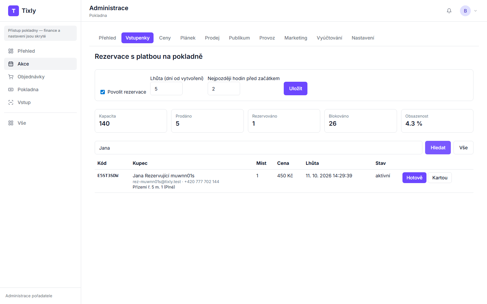
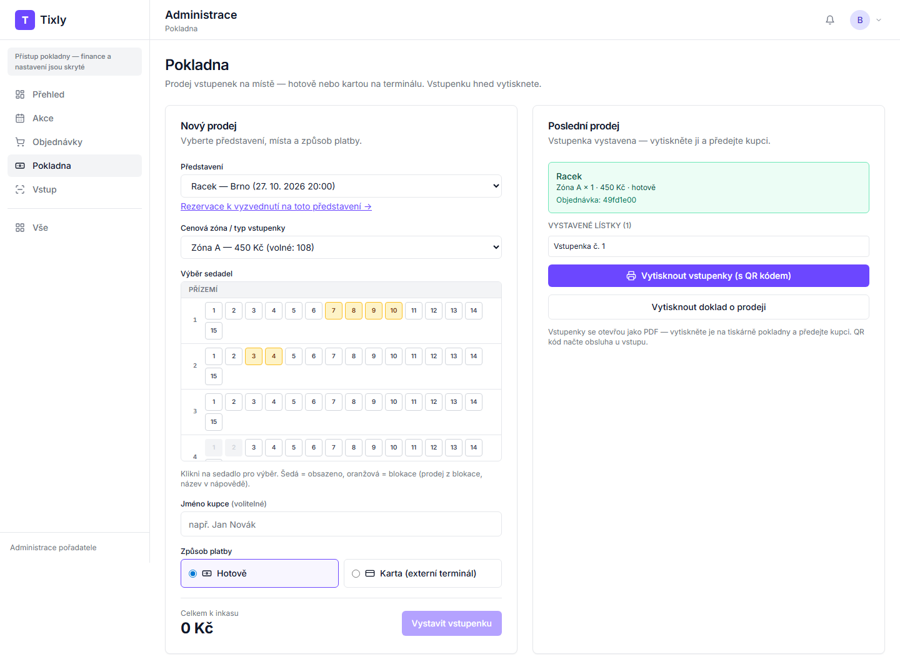

# Tixly — příručka pro pokladnu

Jedna stránka pro pokladní: vyzvednutí rezervace, prodej na místě, tisk vstupenek.

## Co potřebujete mít připravené

- Přihlašovací e-mail a heslo (účet s rolí **Pokladna** — pozvánku pošle vlastník agentury).
- Počítač nebo tablet u pokladny s tiskárnou (vstupenky se otevřou jako PDF s QR kódem).
- Hotovost na vracení a platební terminál (karty se platí na vlastním terminálu, Tixly jen zaznamená „kartou").

Po přihlášení máte v menu: **Přehled · Akce · Objednávky · Pokladna · Vstup**.

## Vyzvednutí a zaplacení rezervace

1. Menu **Pokladna** → v poli **Představení** vyberte představení (název — město, datum a čas).
2. Klikněte na **Rezervace k vyzvednutí na toto představení**.
3. Do jednoho pole napište **kód rezervace, jméno, e-mail nebo telefon** a klikněte na **Hledat** (nebo Enter). Kód celý;
   u jména a e-mailu stačí část; u telefonu aspoň 6 číslic (např. posledních 6).
4. U rezervace klikněte na **Hotově** nebo **Kartou**. Objeví se „Rezervace … zaplacena: … vstupenek, doklad …".
5. Klikněte na **Vytisknout vstupenky (s QR kódem)** a vstupenky předejte. Kupec je dostane i e-mailem.

## Prodej na místě

1. Menu **Pokladna** → **Představení** → **Cenová zóna / typ vstupenky**.
2. Klikněte na místa v plánku (čísla = místa v řadě, vlevo číslo řady). Šedá = prodáno, oranžová = blokace (prodej z blokace,
   název blokace v nápovědě po najetí myší).
3. Jméno kupce je nepovinné. Zvolte **Hotově** nebo **Karta (externí terminál)** — „Celkem k inkasu" ukazuje částku.
4. Klikněte na **Vystavit vstupenku**.
5. Klikněte na **Vytisknout vstupenky (s QR kódem)**. **Vytisknout doklad o prodeji** vytiskne účtenku.

Slevová kategorie (senior, student) se na pokladně nevybírá — prodává se cena zóny. Zlevněnou vstupenku prodejte jako rezervaci
nebo online.

## Když něco nefunguje

| Co vidíte | Co udělat |
|---|---|
| Rezervace se nenajde | Zkuste jiný údaj (kód, příjmení, e-mail, telefon). Zkontrolujte, že máte vybrané správné představení (město a datum). Propadlá rezervace už v seznamu není — místa se vrátila do prodeje. |
| V seznamu představení je víc stejných názvů | Rozlišíte je podle města a data v závorce. |
| Tlačítko **Vystavit vstupenku** je šedé | Vyberte typ vstupenky a aspoň jedno místo. |
| „Některé místo mezitím někdo prodal" | Obnovte stránku a vyberte jiné místo. |
| PDF se vstupenkami se neotevře | Povolte v prohlížeči vyskakovací okna pro Tixly, nebo klikněte na odkaz znovu. |
| „Přihlášení vypršelo" | Přihlaste se znovu. |
| Nejde internet | Prodej ani výdej rezervací bez internetu nefunguje. Zapište si kupce a místa na papír a prodej dokončete po obnovení spojení; volejte vedoucí. |
