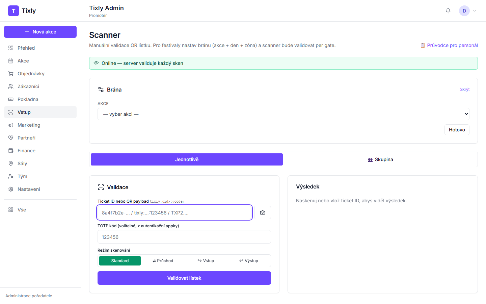
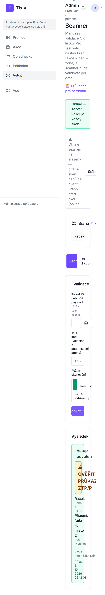
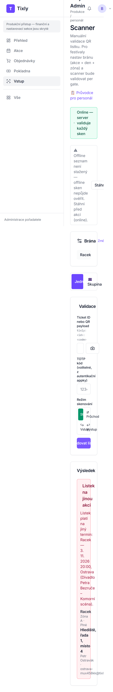
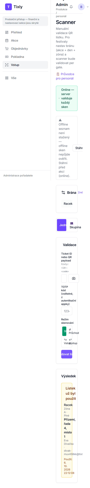

# Tixly — příručka pro vstup (uvaděčky a kontrola vstupenek)

Jedna stránka pro obsluhu u vstupu: skenování, co znamenají výsledky, co dělat při výpadku internetu a při odmítnuté
vstupence.

## Co potřebujete mít připravené

- Mobil nebo tablet s nabitou baterií, internetem a fotoaparátem.
- Přihlašovací e-mail a heslo (role **Staff (scanner / read-only)** — pozvánku pošle vlastník agentury).
- **Před otevřením sálu, ještě s internetem:** stažený offline seznam vstupenek (krok 3).
- Seznam pro uvaděče (PDF) od produkce — kdo má mít průkaz (ZTP/P, student…).

## Postup

1. Přihlaste se a v levém menu zvolte **Vstup**. Otevře se **Scanner**.
2. **Brána:** v poli **Akce** vyberte dnešní představení a klikněte na **Hotovo**.
3. Klikněte na **Stáhnout offline seznam**. Pak se ukáže „Offline seznam: … lístků · staženo …".
4. U příchozího klikněte na ikonu **fotoaparátu** vedle pole „Ticket ID nebo QR payload" a namiřte na QR kód vstupenky,
   nebo kód opište do pole. Klikněte na **Validovat lístek**.
5. Podívejte se na **Výsledek**:

| Výsledek | Co udělat |
|---|---|
| Zelené **Vstup povolen** + místo | Pustit, ukázat místo. |
| Zelené **Vstup povolen** + oranžové **⚠ OVĚŘIT PRŮKAZ: ZTP/P** (student, senior…) | Zkontrolovat průkaz. Bez průkazu poslat na pokladnu. |
| Červené **Lístek na jinou akci** + správné datum a místo | Nepouštět. Říct, na kdy vstupenka platí; s výměnou pomůže pokladna. |
| Oranžové **Lístek už byl použit** + čas prvního vstupu | Nepouštět. Zavolat vedoucí (možná kopie vstupenky). |
| Červené **Neplatný kód vstupenky** / jiná červená hláška | Nepouštět, poslat na pokladnu. |
| Červené **Chyba** + „OFFLINE: lístek nelze ověřit (není stažený seznam) — zkontroluj ho ručně." | Vstupenku nešlo ověřit (výpadek internetu, seznam nestažený). Zkontrolujte na vstupence název, datum a čas představení. |

  

## Výpadek internetu

- Nahoře se místo „Online — server validuje každý sken" ukáže „**Offline — skeny jdou do lokální fronty**". Skenujte dál.
- Se staženým offline seznamem skener pozná platnou vstupenku („Přijato offline (ověřeno proti staženému seznamu)"), cizí
  („OFFLINE: lístek NENÍ ve staženém seznamu platných — NEVPOUŠTĚT.") i druhý průchod na tomto zařízení.
- **Bez staženého seznamu** skener vstupenku ověřit neumí: ukáže **Chyba** „OFFLINE: lístek nelze ověřit … zkontroluj ho
  ručně." — zkontrolujte vstupenku očima. Totéž se ukáže, když internet vypadne během ověřování.
- Skeny se uloží v zařízení („… čeká na sync"). Po návratu internetu se odešlou samy, nebo klikněte na **Synchronizovat**.

## Když něco nefunguje

| Co vidíte | Co udělat |
|---|---|
| Fotoaparát se neotevře | Povolte prohlížeči přístup ke kameře (nastavení prohlížeče → oprávnění webu). Mezitím kód opište. |
| V poli **Akce** není dnešní představení | Zkontrolujte přihlášení k účtu správné agentury; zavolejte vedoucí. |
| **Lístek na jinou akci** u více lidí | Zkontrolujte bránu — klikněte na **Změnit** a vyberte správné představení. |
| **Chyba** „OFFLINE: lístek nelze ověřit" u všech | Výpadek internetu a offline seznam nebyl stažený — kontrolujte vstupenky očima; po obnovení internetu klikněte na **Synchronizovat**. |
| Zařízení se vybilo | Pokračujte na jiném: přihlásit, **Vstup**, vybrat představení, **Stáhnout offline seznam**. |
